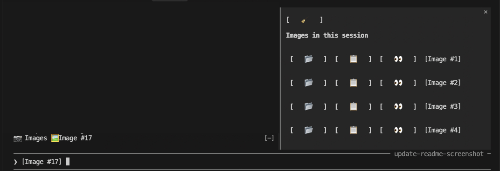

# image-preview

A Claude Code mod for previewing images you paste or drop into the prompt.

## Why

You paste or drop an image into the prompt, don't submit, and step away. When you come back, the prompt only shows `[Image #1]`, and you can't tell which image that was. Claude Code has no way to preview it from the prompt. This was raised in [anthropics/claude-code#68986](https://github.com/anthropics/claude-code/issues/68986), which was closed.

This mod fills the gap: the `🖼 Image #N` chips above the prompt open the pending image in a browser window, where you can also open it in your OS viewer. It works for images pasted from the clipboard as well as dropped files, before you submit. Type a space after the `[Image #N]` tag that Claude Code inserts, so the chip appears.



## What it does

- **Band above the prompt:** a `🖼  Image #N` chip for each `[Image #N]` in your draft. Clicking a chip opens the image browser on that image (and, if the window can't start, the image in the OS viewer). If the browser window is already open, it switches to that image instead of opening a second window.
- **Image browser (`/image-preview`):** a window with a master/detail layout. The left table lists this session's images (number, name, size, source) with a filter box. The right side previews the selected image in the browser itself, with Fit and 100% zoom, and shows its path, dimensions, size and date. Buttons open the image in the **OS viewer** (Preview on macOS), show it in the file manager (Finder on macOS), and copy its path. Arrow keys move through the table, Enter opens the OS viewer, and double-clicking a row does too. The theme follows your system (Light and Dark are selectable) and the list refreshes as you add images.
- **Slash command:** `/image-preview` opens the browser. `/image-preview 2` opens image 2 in the OS viewer directly. `/image-preview pane` opens the older terminal pane (a plain list with buttons), which also works where the window can't run.

## How it works

The mod watches your draft for `[Image #N]` tags. For a dropped file it remembers the original path. Otherwise it finds the copy Claude Code saved at `<tmp>/claude-<uid>/<project>/<session>/images/N.<ext>`. The chips and the browser use whichever is available, and show a notice if neither is.

`/image-preview` starts a small local web server (`server/server.mjs`, no dependencies) and opens its page in a Chrome app window with its own profile, the same approach as [gui-editors](https://github.com/sandipchitale/gui-editor):

```
Claude Code session
  └─ mod (hooks/register.tsx, hooks/gui.ts)
       ├─ $.process.spawn  ──►  node server/server.mjs      (lives and dies with the mod)
       ├─ $.http.fetch     ──►  POST /open-window, /sync, /ping
       └─ /image-preview command
                                   ├─ serves the page on 127.0.0.1:<random port>
                                   ├─ lists the session's images and streams them to the page
                                   └─ opens or reveals files with the OS (`open`, `xdg-open`, `explorer`)
```

The server exits about a minute after the mod stops sending its heartbeat. If it can't start, `/image-preview` falls back to the terminal pane.

**Safety.** Everything binds to `127.0.0.1`. A request whose `Host` isn't `127.0.0.1:<port>` is refused (DNS rebinding), and every API call needs a per-run token that only the served page and the mod know. The server only serves files that are on its own list (this session's saved images and the dropped files the mod reported), never a path from the page, and runs commands as `argv` arrays, never through a shell.

## Install

Try it from a checkout:

```
claude --plugin-dir /path/to/image-preview
```

Or install it from GitHub, inside Claude Code:

```
/plugin marketplace add sandipchitale/claude-code-image-preview
/plugin install image-preview@image-preview
```

Then run `/reload-plugins` (or restart). Choose **user** scope to use it in every project.

## Limits

- Built and tested on Claude Code v2.1.292 on macOS, with Sonnet 5.5.
- The browser window needs the CLI (`$.process` isn't available in the desktop app or IDE extensions), Node 18+, and Chrome. Without Chrome it opens your default browser instead. Elsewhere, use `/image-preview pane`.
- The chip appears only after you type a space after the `[Image #N]` tag.
- Open and reveal try the first command that works on your system:

  | OS | Open | Reveal |
  |---|---|---|
  | macOS | `open` | `open -R` (selects the file) |
  | Linux | `xdg-open` | `xdg-open` on the folder (the file is not selected) |
  | Windows | `cmd /c start` | `explorer /select,` |

- **Linux and Windows have not been tested.** The commands above are untested there. Only macOS has been tried. The window finds saved images in `/private/tmp` and `/tmp` (and the pane uses `find` over them), so the saved-image lookup is untested outside macOS.
- The mod API has no hook for clicks on the native `[Image #N]` widget, so the chips above the prompt stand in for it.
- The terminal pane's tooltip positions assume fixed button widths. A terminal that draws emoji at a different width may misplace them.
- The terminal inverts a `Button`'s colors on hover or focus, and the mod can't turn that off.
- A button in the terminal pane may need a second click if the pane doesn't hold focus.

## License

MIT
